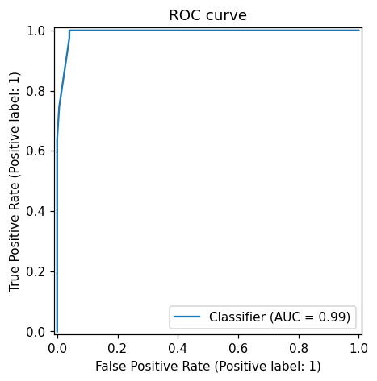
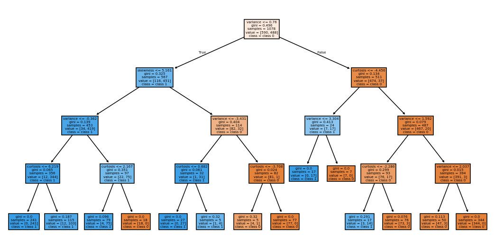
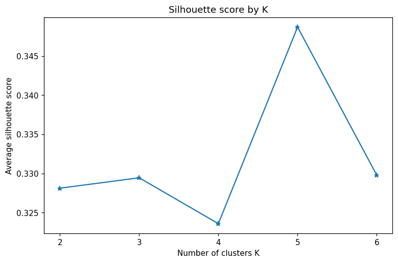
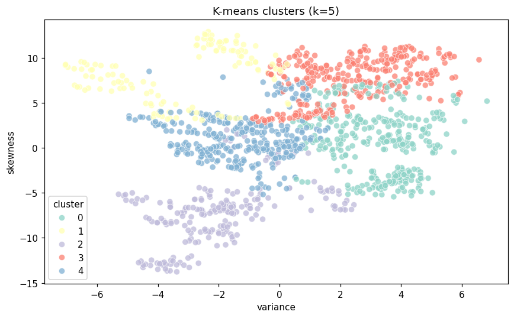

# Banknote Authentication Analysis

**Author:** Benjamin Dwomoh  
**Portfolio context:** Developed from MSc Data Analytics coursework and revised for reproducibility, classification interpretation and responsible model reporting.
**Tools:** Python, pandas, NumPy, Matplotlib, seaborn and scikit-learn

## Project overview

This project uses four image-derived numerical features to classify the binary labels in the UCI Banknote Authentication dataset. A constrained Decision Tree is evaluated on a stratified holdout set using accuracy, precision, recall, F1-score, specificity, a confusion matrix and ROC-AUC. A separate K-means analysis explores whether the feature space contains additional descriptive groups without using the class labels.

The project demonstrates a complete classification workflow while maintaining an important distinction: the supplied CSV identifies the target only as numeric classes 0 and 1, so the analysis does not independently assume which class means genuine or counterfeit.

## Business problem

Automated authentication systems can support fraud-screening processes by identifying observations that require further examination. In a real application, the acceptable balance between false positives and false negatives would depend on which class represents a counterfeit note, the financial cost of each error and the role of human verification.

This analysis addresses four questions:

1. Can the four image-derived features distinguish the supplied binary classes?
2. How does the Decision Tree perform on observations not used for training?
3. What types of classification errors occur?
4. What natural groups emerge when the known labels are temporarily ignored?

## Dataset and contribution

The source contains **1,372 observations** with the following variables:

- Variance of wavelet-transformed image
- Skewness of wavelet-transformed image
- Curtosis of wavelet-transformed image
- Entropy of image
- Binary class label

I prepared and validated the data, removed duplicates, constructed the classification workflow, evaluated the Decision Tree, performed the exploratory clustering and interpreted the results. I did not collect the original banknote images or extract the supplied features.

Removing **24 exact duplicate rows** retained **1,348 observations**:

| Class | Observations |
|---|---:|
| Class 0 | 738 |
| Class 1 | 610 |
| **Total** | **1,348** |

## Analytical workflow

1. Load the supplied CSV and standardise column names.
2. Inspect data types, missing values, duplicates and class counts.
3. Remove exact duplicates and validate numeric fields.
4. Create a stratified 80/20 train-test split.
5. Train a Decision Tree with `max_depth=4` and `min_samples_leaf=5`.
6. Evaluate the held-out predictions using classification metrics, a confusion matrix and ROC-AUC.
7. Standardise the four predictors for K-means clustering.
8. Compare cluster counts from k=2 to k=6 using inertia and silhouette scores.
9. Cross-tabulate the selected clusters against the known classes for descriptive comparison only.

## Classification results

The stratified test set contained **270 observations**.

| Metric | Test result |
|---|---:|
| Accuracy | 97.78% |
| Precision for class 1 | 95.31% |
| Recall/sensitivity for class 1 | 100.00% |
| Specificity for class 0 | 95.95% |
| F1-score for class 1 | 97.60% |
| ROC-AUC | 0.993 |

Specificity was calculated as `142 / (142 + 6) = 95.95%` from the confusion matrix.

### Confusion matrix

| Actual / predicted | Class 0 | Class 1 |
|---|---:|---:|
| Class 0 | 142 | 6 |
| Class 1 | 0 | 122 |


The model correctly classified all 122 class-1 test observations and incorrectly assigned six class-0 observations to class 1. Because the supplied file does not independently define the real-world meaning of classes 0 and 1, these errors should not be labelled as missed counterfeits or rejected genuine notes without verified class documentation.

### ROC curve



The ROC-AUC of 0.993 indicates strong ranking separation on this particular holdout split. It does not establish production performance on new currencies, imaging equipment or operating conditions.

### Interpretable Decision Tree



Constraining tree depth and minimum leaf size makes the fitted rules easier to inspect and reduces unrestricted tree growth. The displayed rules describe this fitted sample and should not be treated as universal authentication rules.

## Exploratory clustering

K-means was applied separately from the supervised evaluation. Among k=2 to k=6, **k=5** produced the highest silhouette score of **0.349**.



The five clusters contained different mixtures of the two known classes:

| Cluster | Class 0 | Class 1 | Total |
|---|---:|---:|---:|
| 0 | 329 | 8 | 337 |
| 1 | 60 | 71 | 131 |
| 2 | 47 | 179 | 226 |
| 3 | 254 | 68 | 322 |
| 4 | 48 | 284 | 332 |



These are descriptive feature groups, not five authentication categories. The crosstab shows partial alignment with the binary labels, but clustering does not replace supervised classification or verified domain labels.

## Operational interpretation and recommendations

- **Verify the label definition first:** Before real-world use, confirm which target value represents each authentication outcome from authoritative dataset documentation and preserve that mapping throughout the pipeline.
- **Define error costs:** Decide whether a false negative or false positive carries greater operational risk, then select thresholds and metrics accordingly.
- **Use human review for uncertain cases:** A production workflow should route low-confidence or high-risk observations for additional inspection rather than relying solely on a binary prediction.
- **Validate across operating conditions:** Test performance on new banknote batches, currencies, imaging equipment and acquisition environments.
- **Monitor drift:** Feature distributions may change when sensors, note designs or image-processing procedures change.
- **Compare multiple classifiers:** Future work should benchmark Logistic Regression, Support Vector Machine, Random Forest and calibrated models using cross-validation.

## Limitations

- The source provides extracted numerical features, not the original banknote images.
- The supplied CSV does not independently document the real-world meanings of numeric classes 0 and 1.
- Results come from one stratified random split of a small benchmark dataset.
- No cross-validation, external validation or hyperparameter search is included.
- Duplicate removal reduces exact overlap but does not rule out closely related observations.
- ROC-AUC and aggregate accuracy do not capture every operational error cost.
- The probability outputs are not assessed for calibration.
- K-means clusters are descriptive and are not guaranteed to reproduce the known classes.
- The results do not constitute evidence of deployment readiness for fraud detection.

## Run the analysis

Use Python 3.11 or newer. From the repository folder, create and activate a virtual environment.

```bash
python -m venv .venv
```

Windows PowerShell:

```powershell
.venv\Scripts\Activate.ps1
```

macOS/Linux:

```bash
source .venv/bin/activate
```

Install the packages and start Jupyter:

```bash
python -m pip install -r requirements.txt
python -m jupyter lab
```

Place the source dataset in `data/` as described in [data/README.md](data/README.md). Open [analysis.ipynb](analysis.ipynb), restart the kernel and run all cells. Saved outputs are included for readers who only want to inspect the work.

## Repository structure

```text
banknote-authentication-analysis/
├── analysis.ipynb       # Explained analysis with executed outputs
├── figures/             # Six exported analysis charts
├── data/README.md       # Dataset source and placement instructions
├── requirements.txt     # Analysis dependencies
├── VALIDATION.md        # Execution and scope checks
├── LICENSE              # Licence for the original project code
└── README.md            # Project overview and findings
```

## Validation

The analytical workflow underlying the saved results was executed sequentially against the supplied dataset without errors. A later presentation-only cleanup consolidated duplicate imports without changing the analytical logic or saved results. See [VALIDATION.md](VALIDATION.md) for details.

## Data source

Lohweg, V. (2012). *Banknote Authentication*. UCI Machine Learning Repository.

https://doi.org/10.24432/C55P57

https://archive.ics.uci.edu/dataset/267/banknote+authentication

UCI lists the dataset under the CC BY 4.0 licence. The repository does not redistribute the raw dataset.
