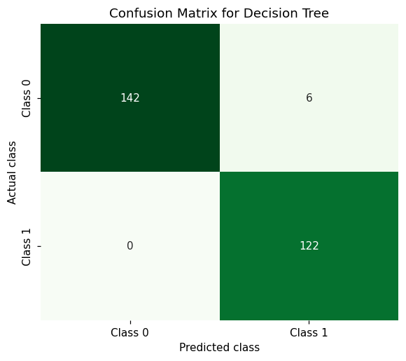

# Banknote Authentication Analysis

**Author:** Benjamin Dwomoh  
**Context:** MSc Data Analytics coursework, reviewed for a public portfolio  
**Tools:** Python, pandas, NumPy, Matplotlib, seaborn, scikit-learn

## Analytical question

Can four image-derived numerical features separate the supplied binary classes, and what groups emerge without using the labels?

## Data and my contribution

1,372 source observations with variance, skewness, curtosis, entropy and a binary class field. Supplied for my MSc assignment. I worked on data preparation, analysis, modelling and interpretation; I did not collect the original dataset.

## Approach

Duplicate removal and numeric validation; stratified 80/20 holdout; constrained Decision Tree classifier; accuracy, precision, recall, F1, confusion matrix and ROC-AUC; standardisation and exploratory K-means clustering.

## Results

- Removing **24 duplicate rows** retained **1,348 observations**.
- On the stratified **270-observation test set**, the Decision Tree achieved **97.78% accuracy**, **95.31% precision**, **100% recall** and **97.60% F1** for numeric class 1; ROC-AUC was **0.993**.
- The confusion matrix contained 142 correct class-0 predictions, 122 correct class-1 predictions, 6 false positives and 0 false negatives for class 1.
- Exploratory K-means selected **5 clusters** among k=2 to k=6, with a silhouette score of **0.349**. These clusters are descriptive groups, not five authentication categories.

## Example chart



## Limitations

The supplied CSV does not establish which numeric class is genuine; the notebook reports class 0 and class 1. Results are from a single random split on a small benchmark, not a deployment study. Clusters are descriptive and need not match the labels. The optional binary-target linear regression exercise was omitted in this focused portfolio edition.

## Run the analysis

Use Python 3.11 or newer. From this repository folder:

```bash
python -m venv .venv
```

Activate the environment on Windows PowerShell:

```powershell
.venv\Scripts\Activate.ps1
```

Or on macOS/Linux:

```bash
source .venv/bin/activate
```

Then install the packages and start Jupyter:

```bash
python -m pip install -r requirements.txt
python -m jupyter lab
```

Place the source dataset in `data/` as described in [data/README.md](data/README.md). Open [analysis.ipynb](analysis.ipynb), then restart the kernel and run all cells. The notebook includes saved outputs for readers who only want to inspect the work.

Core analysis package versions are pinned to the validation environment. JupyterLab is a frontend dependency; it was not available in the validation environment. Validation executed Python cells sequentially with a lightweight runner and captured tables and Matplotlib outputs rather than using a Jupyter kernel.


## Files

- `analysis.ipynb`: explained analysis with executed outputs.
- `figures/`: saved charts produced by the notebook.
- `requirements.txt`: analysis dependencies.
- `data/README.md`: dataset source and placement instructions.
- `VALIDATION.md`: execution checks and scope.

## Source

Lohweg, V. (2012). Banknote Authentication. UCI Machine Learning Repository. https://doi.org/10.24432/C55P57. UCI lists the dataset under CC BY 4.0.

https://archive.ics.uci.edu/dataset/267/banknote+authentication
